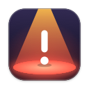
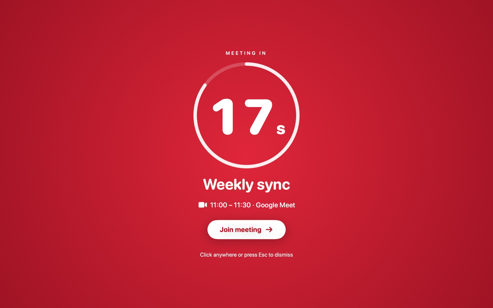
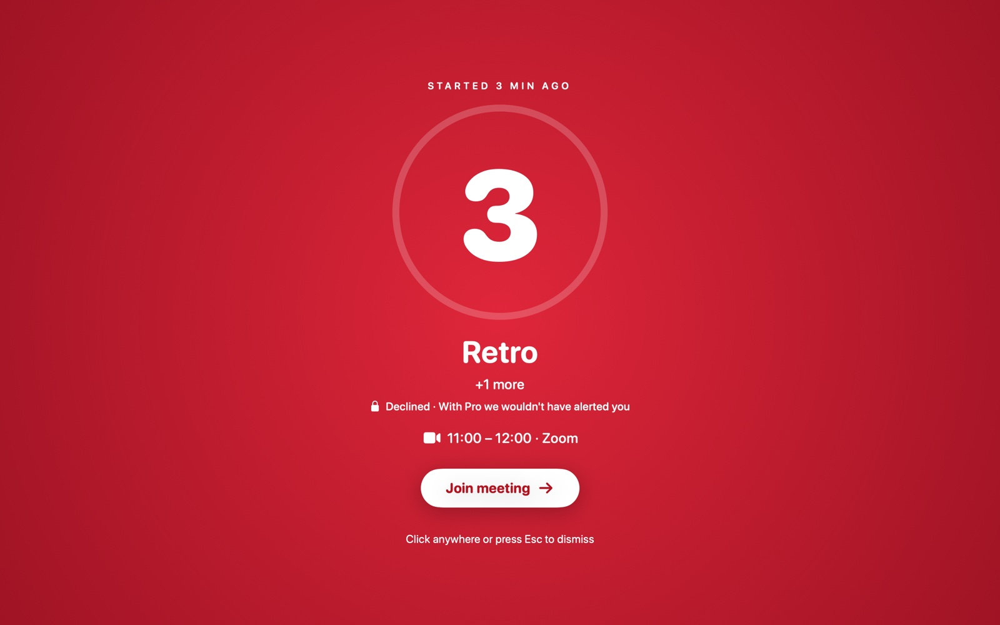
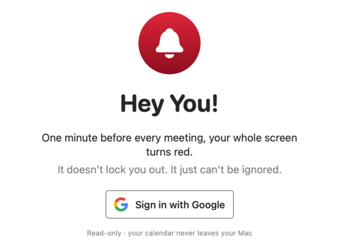

<p align="center">
  
</p>

<h1 align="center">Hey You!</h1>

<p align="center"><strong>20 seconds before every meeting, your whole screen turns red.</strong><br>
It doesn't lock you out. It just can't be ignored.</p>

<p align="center">
  macOS 14+ · Swift 6 · SwiftUI + AppKit · The Composable Architecture · Google Calendar
</p>

You know the meeting is at 11. You look at the clock at 10:55, and the next time you look it's 11:07. Calendar notifications are a grey box in the corner, exactly the thing your brain has learned to ignore. **Hey You!** is a tiny macOS menu-bar app that reads your Google Calendar and, 20 seconds before every meeting, takes over **every screen** with a red alert: the meeting name, a countdown and a **Join meeting** button. It stays up until you react or the meeting ends, and it never traps you: a click, Esc or ⌘Q makes it go away, Enter joins the call.



<sub>Off-screen render of the real `AlertView` from the snapshot tests (`SnapshotRenderTests`), not a photo of a running Mac.</sub>

## Contents

- [Features](#features) · [How it works](#how-it-works) · [Install](#install) · [Build from source](#build-from-source)
- [Configuration](#configuration) · [Architecture](#architecture) · [Testing](#testing) · [Privacy](#privacy)
- [Status and roadmap](#status-and-roadmap) · [FAQ](#faq) · [Development notes](#development-notes) · [License](#license)

## Features

**Free**

- Full-screen red alert **20 s before every timed meeting**, on **every display**, above full-screen apps.
- Detects **Google Meet, Zoom, Microsoft Teams and Webex** links; **Enter** or **Join meeting** opens the call.
- Never auto-closes. If you were away, it keeps going: *NOW*, then *STARTED 3 MIN AGO*.
- Deliberate dismissal only: click, Esc, ⌘W or ⌘Q. Other keys are swallowed and input in the first second is ignored, so a keystroke you were already typing can't dismiss it unseen.
- Lives in the menu bar (no Dock icon) with the next meeting and a **Test alert** item.
- Read-only Google sign-in; your calendar never leaves your Mac.
- English and Spanish.

**Hey You! Pro** (one-time in-app purchase)

- Lead time from 1 to 120 seconds.
- Skip meetings you declined, focus blocks with just you, or meetings without a video link.
- Choose calendars and working hours.
- Sound, countdown in the menu bar and weekly punctuality stats.

| If you were away | First launch |
|---|---|
|  |  |

<sub>Both are off-screen renders from `SnapshotRenderTests`; the onboarding image is cropped above the consent checkboxes, which the renderer can't draw.</sub>

## How it works

1. You sign in with Google (read-only `calendar.readonly` scope). Tokens are kept in the macOS Keychain by Google's Sign-In SDK.
2. Every minute, and after the Mac wakes up, the app fetches the next 24 hours of events from the calendars you have visible in Google Calendar, straight from your Mac to Google. There is no backend.
3. A pure scheduler (`AlertScheduler`) takes the events, the current time and your settings and picks the next alert.
4. When it fires, one panel per screen opens at screen-saver window level, so it also covers full-screen apps.
5. Each meeting alerts once. A meeting already in progress when the app launches is not alerted; one that started while the Mac was asleep is.

The why behind each of these decisions is in the [product spec](docs/PRD.md) (in Spanish).

## Install

**Mac App Store:** coming soon as *Hey You! – Never Be Late*. The listing exists in App Store Connect; the first build hasn't been submitted yet (see [Status](#status-and-roadmap)).

**From source:** follow [Build from source](#build-from-source). To sign in with Google you need your own OAuth client (see [Configuration](#configuration)); without one you can still try everything with the mock calendar.

## Build from source

### Requirements

- macOS 14 or later (the deployment target).
- Xcode 16 or later (Swift 6; tested with Xcode 27.1). If `xcode-select -p` points at the Command Line Tools, either run `sudo xcode-select -s /Applications/Xcode.app` or just use the scripts, which find an installed Xcode on their own (`scripts/env.sh`).
- [Homebrew](https://brew.sh), for [XcodeGen](https://github.com/yonaskolb/XcodeGen), [SwiftLint](https://github.com/realm/SwiftLint) and [SwiftFormat](https://github.com/nicklockwood/SwiftFormat).

Swift packages are resolved automatically: [TCA](https://github.com/pointfreeco/swift-composable-architecture), [Google Sign-In](https://github.com/google/GoogleSignIn-iOS) and [PostHog](https://github.com/PostHog/posthog-ios).

### Commands

```bash
./scripts/bootstrap.sh      # brew install xcodegen swiftlint swiftformat, create Config/Secrets.xcconfig, generate HeyYou.xcodeproj
./scripts/build.sh          # build the app (Debug) into build/DerivedData
./scripts/test.sh           # HeyYouKit package tests (swift test)
./scripts/test.sh --xcode   # everything, including the app-hosted StoreKit tests
./scripts/lint.sh           # swiftformat + swiftlint --strict
open HeyYou.xcodeproj       # or run from Xcode (click "Trust & Enable" for the package macros once)
```

`HeyYou.xcodeproj` is generated from `project.yml` by XcodeGen and is not committed. Run `xcodegen generate` after changing `project.yml`.

### Try it without a Google account

Run the Debug build with the `--mock-calendar` launch argument (already in the generated scheme, unchecked by default: *Edit Scheme → Run → Arguments*). The app then uses a fake account with a meeting 50 seconds after launch, so the red alert appears about 30 seconds after starting. The **Test alert** menu item (alert in 5 s) works in every build.

## Configuration

Secrets live in `Config/Secrets.xcconfig`, which is **gitignored**. `scripts/bootstrap.sh` (and the build/test scripts) create it from [`Config/Secrets.example.xcconfig`](Config/Secrets.example.xcconfig). The project builds with the placeholder values; fill in what you need:

| Key | What it is | Needed for |
|---|---|---|
| `GOOGLE_CLIENT_ID` | OAuth client ID (type iOS) from Google Cloud Console | Signing in with Google |
| `GOOGLE_REVERSED_CLIENT_ID` | The "iOS URL scheme" of that client | Signing in with Google |
| `POSTHOG_API_KEY` | PostHog EU project API key | Optional: analytics are a no-op without it |
| `TEAM_ID` | Your Apple Developer Team ID | Signing (Keychain, App Store) |
| `HEYYOU_SIGN_IDENTITY` | e.g. `Apple Development`; defaults to `-` (ad-hoc, local runs) | Signing |

The bundle ID (`pro.chimi.heyyou`) is defined in one place: `BUNDLE_ID` in `project.yml`.

### Set up Google sign-in (one-time)

The app talks directly to Google from your Mac, so you need your own OAuth client:

1. Open <https://console.cloud.google.com/> and create a project (e.g. "Hey You").
2. **APIs & Services → Library** → enable **Google Calendar API**.
3. **APIs & Services → OAuth consent screen** → User type **External** → fill in app name and support email. Add scope `https://www.googleapis.com/auth/calendar.readonly`. While the app is in *Testing*, add your own Google address under **Test users**.
4. **APIs & Services → Credentials → Create credentials → OAuth client ID** → Application type **iOS** (Google uses this type for native macOS apps too) → Bundle ID `pro.chimi.heyyou` (or yours, see `project.yml`).
5. Copy the **Client ID** into `GOOGLE_CLIENT_ID` and the **iOS URL scheme** into `GOOGLE_REVERSED_CLIENT_ID` in `Config/Secrets.xcconfig`.
6. Run `./scripts/build.sh` again.

Without a client ID the onboarding shows a clear "not set up" message instead of failing. To let other people sign in, Google must verify the app (the calendar scope is *sensitive*): it needs a home page, the privacy policy and a demo video. Until then only test users can sign in. Release steps are in [docs/APP_STORE.md](docs/APP_STORE.md).

## Architecture

All logic lives in the local Swift package [`HeyYouKit/`](HeyYouKit) (with its own `Package.swift`), so it builds and tests from the terminal without opening Xcode. `App/` is only the thin app target that wires it together.

```
App/                 wiring only: @main, AppDelegate, Info.plist, entitlements, assets, .storekit
AppTests/            tests that need a real app process (StoreKit 2)
HeyYouKit/Sources/HeyYouKit/
  Models/            domain types, MeetingLinkParser, settings + EffectiveSettings (Pro gating)
  Scheduling/        AlertScheduler: pure (events + now + settings + fired → next alert)
  GoogleCalendar/    Calendar REST API v3, DTOs, mapper
  GoogleAuth/        thin wrapper over Google Sign-In
  Analytics/         closed event taxonomy, consent-gated pipeline, PostHog backend
  Clients/           TCA dependencies (auth, calendar, store, analytics, system)
  Features/          TCA reducers: App, Alert, Settings, Onboarding, Paywall (+ derived MenuBar state)
  Presentation/      ready-to-display texts and time formatting, unit-tested
  UI/                SwiftUI views: lay out state, send actions, nothing else
  AlertWindow/       AppKit: one alert panel per screen, windows for onboarding and paywall
Config/              xcconfigs (Secrets.xcconfig is gitignored)
scripts/             bootstrap / build / test / lint / icon and strings helpers
docs/                PRD, architecture, QA, App Store checklist, screenshots
```

In short: TCA. `AppFeature` owns sync, scheduling and alert presentation; `AlertScheduler` is a pure function; settings always go through `EffectiveSettings` so Pro gating lives in one place; reducers never read the clock directly (`continuousClock`, `date.now`). The full picture and the deviations from the plan are in [docs/ARCHITECTURE.md](docs/ARCHITECTURE.md).

## Testing

```bash
./scripts/test.sh           # package tests with Swift Testing (swift test)
./scripts/test.sh --xcode   # + app-hosted StoreKit 2 tests against App/HeyYou.storekit
```

Every reducer has `TestStore` tests, and the pure logic (scheduler, meeting-link parser) is fully tested. The latest QA pass recorded 160 package tests + 2 app-hosted, all green. What was verified by hand, what only by tests and what is still pending (multi-monitor, Zoom screen sharing, Keynote) is tracked in [docs/QA.md](docs/QA.md), with a 10-minute manual checklist.

Screens can be re-rendered to PNG (this is where the images above come from):

```bash
cd HeyYouKit && HEYYOU_SNAPSHOTS=$PWD/../docs/screenshots swift test --filter SnapshotRenderTests
```

## Privacy

- **Calendar:** read-only access to your Google Calendar and your email address. Events for the next 24 hours are read on your Mac, kept in memory only and never sent to us or anyone else. There are no Hey You! servers. The app never writes to your calendar and never reads mail or contacts. Revoke access any time at <https://myaccount.google.com/permissions> or with **Settings → Disconnect**.
- **Tokens:** stored in the macOS Keychain by Google's Sign-In SDK.
- **Analytics (opt-in):** if you allow it, anonymous usage events go to PostHog in the EU. They never contain meeting titles, links, locations, attendees, calendar names or anything you type; the event type has no free-text case, and with the toggle off nothing is sent at all.
- **Email (opt-in, off by default):** only if you choose "Email me about new features".
- **Purchases:** handled by the App Store.

Full policy: [PRIVACY.md](PRIVACY.md), published at <https://chimi.pro/legal/hey-you/privacy>.

## Status and roadmap

**Version 1.0.0, preparing for the Mac App Store.**

- [x] Core app: alert, scheduler, Google sign-in and calendar, menu bar, settings, onboarding, Pro paywall (StoreKit 2), analytics with consent, English + Spanish.
- [x] Real Google sign-in verified with a signed build ([docs/QA.md](docs/QA.md)).
- [x] Privacy policy published; App Store Connect listing created.
- [ ] Remaining manual QA: multiple monitors, screen sharing, Keynote, launch at login, StoreKit purchase/restore in Xcode.
- [ ] Google OAuth verification of the `calendar.readonly` scope (until then, test users only).
- [ ] First App Store submission with the Pro in-app purchase ([docs/APP_STORE.md](docs/APP_STORE.md)).

Later, if the app works for people: more calendar sources through the system calendar (iCloud, Exchange), which the `CalendarClient` abstraction already allows. Plans and trade-offs: [docs/PRD.md](docs/PRD.md) (product, Spanish) and [PLAN.md](PLAN.md) (technical plan, Spanish).

## FAQ

**Why does it ask for my Google account?** To read when your meetings are. The scope is read-only (`calendar.readonly`).

**What does it store?** Settings, your consent choices, whether you own Pro and your weekly punctuality count, in the app's preferences. Google tokens are in the Keychain. Calendar data is only held in memory.

**Can I close the alert?** Yes: a click anywhere, Esc, ⌘W or ⌘Q closes it, Enter joins the call. If you are away, it closes by itself when the meeting ends (at most 2 hours after the start). ⌘Q while an alert is visible only closes the alert; from the menu, Quit closes the app.

**Does it work with Outlook, iCloud or the Mac Calendar?** Not yet. v1 is Google Calendar only.

**Free vs Pro?** Free alerts 20 s before every timed meeting. Pro is a one-time purchase, no subscription; see [Features](#features).

## Development notes

- Agent and contributor conventions: [CLAUDE.md](CLAUDE.md) (TCA patterns, strict concurrency, no `Date()` in reducers, every reducer tested, conventional commits).
- Debug launch arguments: `--mock-calendar` (fake account and meetings), `--print-changes` (logs every action).
- Strings: `HeyYouKit/Sources/HeyYouKit/Resources/Localizable.xcstrings` (en + es). After adding strings, build once and run
  `python3 scripts/make-strings.py HeyYouKit/.build/out/Intermediates.noindex/HeyYouKit.build/Debug/HeyYouKit-t.build/Objects-normal/arm64 HeyYouKit/Sources/HeyYouKit/Resources/Localizable.xcstrings`
  (it fails if a Spanish translation is missing).
- Release (archive, export, signing pitfalls, store metadata): [docs/APP_STORE.md](docs/APP_STORE.md).

## License

No license file has been added yet, so all rights are reserved by the author.

---

Made by [Nicolás Patarino](https://chimi.pro) · Contact: hola@chimi.pro
