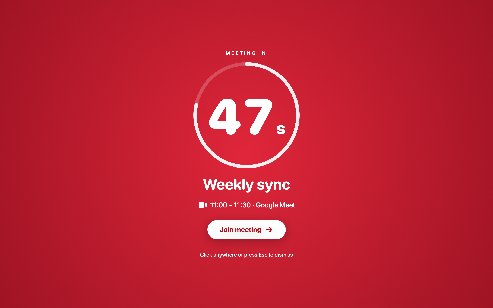

# Hey You!

A macOS menu-bar app that reads your Google Calendar and, one minute before every meeting, turns **every screen** red with the meeting name, a countdown and a **Join meeting** button. The alert never closes by itself; a click, Esc or ⌘Q dismisses it.



- Product spec: [docs/PRD.md](docs/PRD.md)
- Technical plan: [PLAN.md](PLAN.md)
- Privacy policy: [PRIVACY.md](PRIVACY.md)
- QA notes: [docs/QA.md](docs/QA.md) · App Store checklist: [docs/APP_STORE.md](docs/APP_STORE.md)

## Requirements

- macOS 14 or later
- Xcode 16 or later (tested with Xcode 27.1). If `xcode-select -p` points at the Command Line Tools, either run
  `sudo xcode-select -s /Applications/Xcode.app` or just use the scripts below, which find Xcode on their own.
- Homebrew (for `xcodegen`, `swiftlint`, `swiftformat`)

## Build and run

```bash
./scripts/bootstrap.sh      # installs tools, creates Config/Secrets.xcconfig, generates HeyYou.xcodeproj
./scripts/test.sh           # runs the HeyYouKit test suite (swift test)
./scripts/test.sh --xcode   # everything, including StoreKit tests hosted in the app
./scripts/build.sh          # builds the app (Debug) into build/DerivedData
./scripts/lint.sh           # swiftformat + swiftlint --strict
open HeyYou.xcodeproj       # or run from Xcode (click "Trust & Enable" for the package macros once)
```

All logic lives in the local Swift package `HeyYouKit/` (a folder with its own `Package.swift`), so you can build and test it from the terminal without opening Xcode. `App/` is only the thin app target that wires it together. `HeyYou.xcodeproj` is generated from `project.yml` and is not committed.

### Try it without a Google account

Run the Debug build with the `--mock-calendar` launch argument (already set in the generated scheme, unchecked by default). The app then uses a fake calendar with a meeting 90 seconds from launch, so the red alert appears about 30 seconds after starting. The menu-bar item **Test alert** works in every build.

## Configure Google sign-in (one-time, done by you)

The app talks directly to Google from your Mac. You need your own OAuth client:

1. Open <https://console.cloud.google.com/>, create a project (e.g. "Hey You").
2. **APIs & Services → Library** → enable **Google Calendar API**.
3. **APIs & Services → OAuth consent screen** → User type **External** → fill app name, support email.
   Add scope `https://www.googleapis.com/auth/calendar.readonly`. While the app is in *Testing*, add your own Google address under **Test users**.
4. **APIs & Services → Credentials → Create credentials → OAuth client ID** → Application type **iOS** (this is the type Google uses for native macOS apps too) → Bundle ID `pro.chimi.heyyou` (or yours, see `project.yml`).
5. Copy the **Client ID** (`1234-abc.apps.googleusercontent.com`) and the **iOS URL scheme** (`com.googleusercontent.apps.1234-abc`).
6. Edit `Config/Secrets.xcconfig` (gitignored, created from `Config/Secrets.example.xcconfig`):

   ```
   GOOGLE_CLIENT_ID = 1234-abc.apps.googleusercontent.com
   GOOGLE_REVERSED_CLIENT_ID = com.googleusercontent.apps.1234-abc
   POSTHOG_API_KEY = phc_...        # optional, analytics are a no-op without it
   TEAM_ID = ABCDE12345             # your Apple Developer Team ID, needed for signing
   ```

7. `./scripts/build.sh` again.

To let other people sign in, Google must verify the app (the calendar scope is *sensitive*): you need a home page, the privacy policy ([PRIVACY.md](PRIVACY.md)) published at a URL, and a demo video. Until then only test users can sign in.

## Project layout

```
App/                 thin app target: @main, AppDelegate, Info.plist, entitlements, assets, .storekit
HeyYouKit/           Swift package with all logic (TCA features, clients, scheduler, UI, alert window)
Config/              xcconfigs (Secrets.xcconfig is gitignored)
scripts/             bootstrap / build / test / icon generation
docs/                PRD, QA notes, App Store checklist, screenshots
```

## FAQ

**Why does it ask for my Google account?** To read when your meetings are. The scope is read-only (`calendar.readonly`); the app never writes to your calendar and never reads mail or contacts.

**What does it store?** Settings, your consent choices, whether you own Pro and your weekly punctuality count, in the app's preferences. Google tokens are kept in the macOS Keychain by Google's Sign-In SDK. Calendar data is only held in memory.

**Does anything leave my Mac?** Calendar data only travels between your Mac and Google. If you allow it, anonymous usage events (never titles, links, attendees or calendar names) go to PostHog in the EU. See [PRIVACY.md](PRIVACY.md).

**Can I close the alert?** Yes: a click anywhere, Esc, ⌘W or ⌘Q closes it, Enter joins the call. Other keys do nothing, and input in the first second is ignored so you can't dismiss it by accident while typing. ⌘Q while an alert is visible only closes the alert; from the menu, Quit closes the app.

**Free vs Pro?** Free alerts 60 s before every timed meeting. Pro (one-time purchase) adds lead time 10–60 s, filters (declined, no link, just you), calendar choice, working hours, sound, menu-bar countdown and weekly punctuality.

## Development notes

- Architecture: see [docs/ARCHITECTURE.md](docs/ARCHITECTURE.md). In short: TCA. `AppFeature` owns sync, scheduling and alert presentation; `AlertScheduler` is a pure function; settings always go through `EffectiveSettings` so Pro gating lives in one place.
- Debug launch arguments: `--mock-calendar` (fake account and meetings), `--print-changes` (logs every action).
- Screens can be re-rendered to PNG: `cd HeyYouKit && HEYYOU_SNAPSHOTS=$PWD/../docs/screenshots swift test --filter SnapshotRenderTests`.
- Strings: `HeyYouKit/Sources/HeyYouKit/Resources/Localizable.xcstrings` (en + es). After adding strings, build once and run
  `python3 scripts/make-strings.py HeyYouKit/.build/out/Intermediates.noindex/HeyYouKit.build/Debug/HeyYouKit-t.build/Objects-normal/arm64 HeyYouKit/Sources/HeyYouKit/Resources/Localizable.xcstrings`
  (it fails if a Spanish translation is missing).
